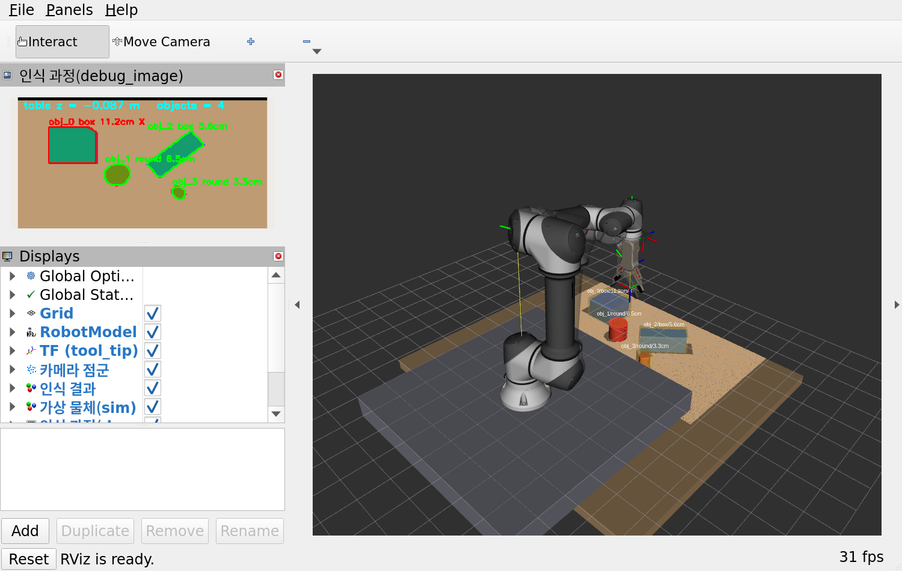
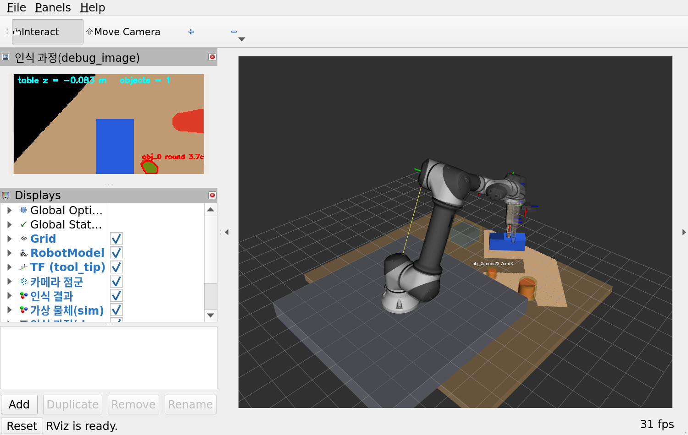
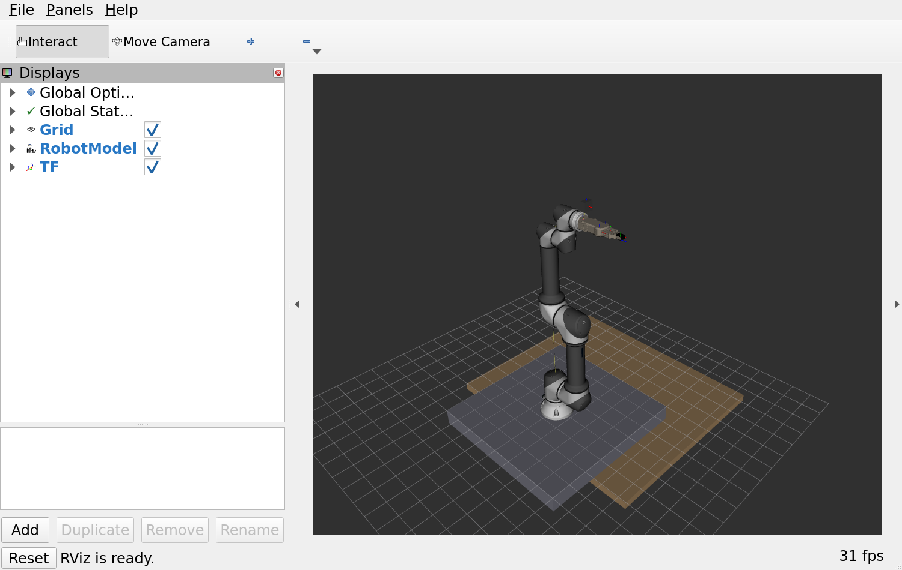
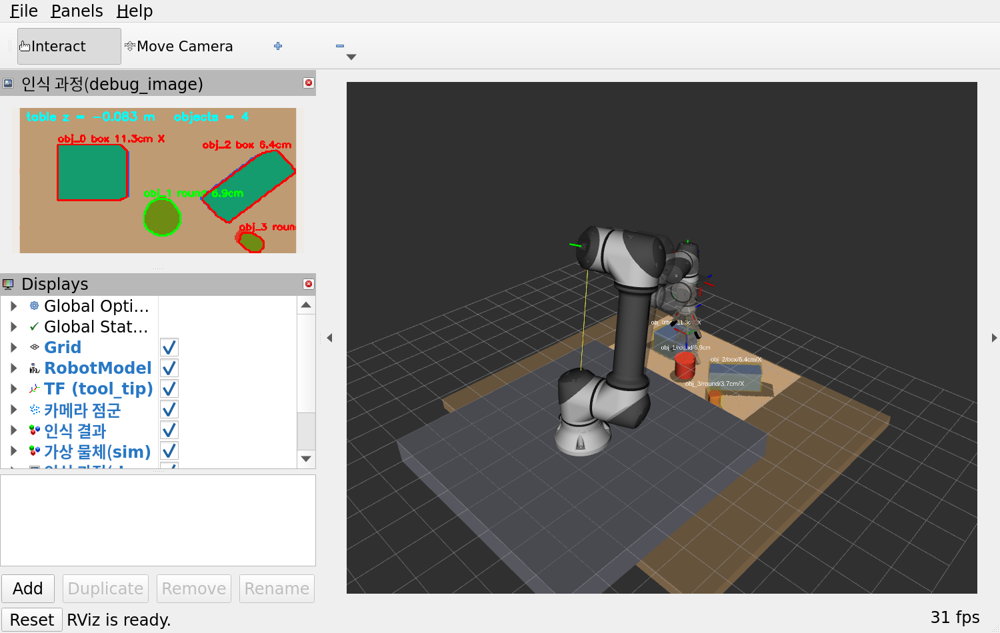
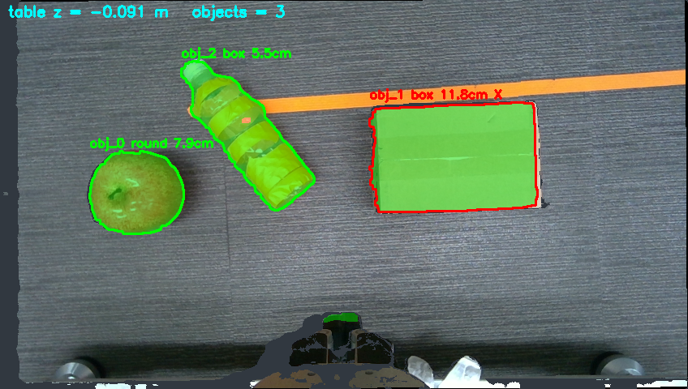

# RB5-850e + D405 Pick and Place 실습 (ROS 2 Humble)

테이블 위 물체(박스·캔·물병·공)를 **손목 카메라(RealSense D405)로 위에서 보고**, 협동로봇 **RB5-850e + OnRobot RG2** 로 집어 옮기는 실습입니다.

```
 1 초기위치 → 2 대기위치 → 3 물체인식 → 4 물체 위 이동 → 5 하강 → 6 잡기 → 7 상승
 → 8 하역 위치 이동 → 9 하강 → 10 놓기 → 11 상승 → (결과 확인) → 12 초기위치
```



로봇·카메라가 없어도 **가상 모드(sim)** 로 시나리오 전체를 똑같이 돌려 볼 수 있습니다.
**수업 전에 집에서 1장(설치·점검)까지 끝내 오세요.** Ubuntu 22.04 만 깔린 노트북에서 시작하면 됩니다.

---

## 1. 사전 설치 (실습 전에 집에서 · 약 1시간)

**출발점: Ubuntu 22.04 만 설치된 노트북.** ROS 는 아래 설치 스크립트가 함께 설치합니다.
명령은 **한 줄씩 복사해서 터미널에 붙여 넣고 Enter** 를 누르면 됩니다.

### 준비물
| 항목 | 조건 |
|---|---|
| 운영체제 | **Ubuntu 22.04 LTS** (데스크톱). 20.04·24.04 는 안 됩니다 — ROS 2 Humble 이 22.04 전용입니다 |
| 디스크 | 여유 **15 GB 이상** (ROS 약 3 GB 를 내려받아 풀면 10 GB 안팎) |
| 메모리 | 8 GB 이상 권장 |
| 인터넷 | 약 3~4 GB 를 내려받습니다. 학교·카페 와이파이보다 집 인터넷이 낫습니다 |
| 계정 | **sudo 비밀번호**(Ubuntu 로그인 비밀번호)를 알아야 합니다 |

> 가상머신(VirtualBox·VMware)도 되지만 RViz(3D 화면)가 느리거나 검게 나올 수 있습니다.
> 가상머신이면 메모리 8 GB·CPU 4개·디스크 40 GB 이상, '3D 가속' 켜기를 권장합니다.

### 1-1. 터미널 열기와 Ubuntu 버전 확인
`Ctrl` + `Alt` + `T` 를 누르면 터미널이 열립니다. 아래를 붙여 넣으세요.
```bash
lsb_release -d          # 결과가 "Ubuntu 22.04.x LTS" 여야 합니다
df -h ~                 # 'Avail(사용 가능)' 이 15G 이상인지 확인
```
> 터미널에 붙여 넣기는 `Ctrl`+`Shift`+`V` 입니다(`Ctrl`+`V` 가 아님).
> 비밀번호를 칠 때 화면에 아무것도 안 보이는 것이 정상입니다. 그대로 치고 Enter.

### 1-2. 시스템 업데이트와 git 설치
```bash
sudo apt update
sudo apt upgrade -y
sudo apt install -y git
```
> `Could not get lock /var/lib/dpkg/lock` 가 나오면 Ubuntu 가 뒤에서 자동 업데이트 중입니다.
> 5~10분 기다렸다가 다시 실행하세요(재부팅해도 됩니다).

### 1-3. 실습 패키지 받기
```bash
git clone https://github.com/karevaros/edu_pick_ws.git ~/edu_pick_ws
```
→ 홈 폴더에 `edu_pick_ws` 폴더가 생깁니다. (`ls ~/edu_pick_ws` 로 확인)

git 을 쓰기 어려우면: GitHub 페이지 초록색 **Code → Download ZIP** → 홈 폴더에 압축을 풀고
폴더 이름을 `edu_pick_ws-main` 에서 **`edu_pick_ws`** 로 바꿉니다.

### 1-4. 설치 스크립트 실행 (ROS 2 포함 · 30~60분)
```bash
cd ~/edu_pick_ws
bash install.sh
```
처음에 sudo 비밀번호를 한 번 묻습니다. 그다음은 기다리기만 하면 됩니다. 스크립트가 하는 일:

| 단계 | 내용 | 시간 |
|---|---|---|
| [0/4] | **ROS 2 Humble 설치** (공식 저장소 등록 → `ros-humble-desktop`) — 이미 있으면 건너뜀 | 15~40분 |
| [1/4] | MoveIt · ros2_control · RealSense 카메라 드라이버 · OpenCV 설치 + 카메라 USB 권한 설정 | 5~15분 |
| [2/4] | 레인보우 로봇 SDK 내려받아 빌드 | 2~5분 |
| [3/4] | 레인보우 ROS 2 드라이버 내려받기 + 실습용 수정 적용 | 1분 |
| [4/4] | 실습 패키지 빌드 · `~/.bashrc` 에 환경 설정 줄 추가 | 2~5분 |

마지막에 `✅ 설치 완료` 가 나오면 성공입니다. 중간에 멈추거나 ❌ 가 나오면 **그대로 다시 `bash install.sh`** —
이미 끝난 단계는 건너뛰고 이어서 합니다.

### 1-5. 점검
**터미널을 모두 닫고 새로 연 뒤**(환경 설정을 다시 읽기 위해):
```bash
bash ~/edu_pick_ws/check_setup.sh
```
1~2분 동안 가상 모드로 로봇이 물체 하나를 옮기는 것까지 자동으로 확인합니다.
마지막 줄이 **`✅ 모두 통과 — 실습 준비 완료`** 면 끝입니다. 성공하면 마지막 부분이 이렇게 나옵니다:
```
      [ 11] 상승 (3 cm 들고 놓였는지 확인)
         ✓ 손가락 사이 비어 있음(점 0개)
      [11+] 결과 확인 (대기위치에서 다시 인식)
         ✓ 원래 자리에서 사라졌습니다 — 옮기기 성공
      [ 12] 초기위치로 이동
      완료 — 1개 옮김
  ✅ Pick and place 1회 성공

통과 24 · 경고 1 · 실패 0          ← 경고 1 = 카메라 미연결(집에서는 정상)
✅ 모두 통과 — 실습 준비 완료
```
- `⚠ D405 연결 안 됨` 은 집에서는 정상입니다(카메라는 실습실에 있습니다).
- ❌ 가 있으면 **터미널 화면 전체를 캡처**해 강사에게 보내 주세요.

### 1-6. 눈으로 확인 (선택 · 5분)
```bash
ros2 launch edu_pick_bringup pick_place.launch.py
```
RViz 창에 받침대·테이블·로봇이 보이면 됩니다. 터미널을 하나 더 열어(`Ctrl`+`Alt`+`T`):
```bash
ros2 run edu_pick_task pick_place
```
로봇이 물체를 집어 옮기면 성공. 끝낼 때는 각 터미널에서 `Ctrl`+`C`.



### 설치가 안 될 때
| 증상 | 조치 |
|---|---|
| `Ubuntu 22.04(jammy) 가 아닙니다` | Ubuntu 버전이 다릅니다. 22.04 를 새로 설치하거나 강사에게 문의 |
| `Could not get lock …` | 자동 업데이트 중. 기다렸다가 다시 |
| `Temporary failure resolving` · 내려받기 실패 | 인터넷 연결 확인 후 `bash install.sh` 다시 |
| `No space left on device` | 디스크 부족. 여유 15 GB 이상 확보 |
| `ros2: command not found` | 새 터미널을 열지 않았습니다. 터미널을 닫고 다시 열거나 `source ~/.bashrc` |
| RViz 가 검은 화면·매우 느림 (가상머신) | 3D 가속 켜기. 그래도 안 되면 `export LIBGL_ALWAYS_SOFTWARE=1` 후 실행 |
| 그 밖의 ❌ | 화면 캡처를 강사에게 |

### 수정본 받기 (강사가 고쳤다고 알려 주면)
```bash
cd ~/edu_pick_ws && git pull && bash install.sh
```
> `scene.yaml` 을 고쳐 둔 상태에서 `git pull` 이 거부되면: `git stash` → `git pull` → `git stash pop`

---

## 2. 구성

| 패키지 | 내용 |
|---|---|
| `edu_pick_description` | 로봇 모델(URDF): 테이블 + RB5 + RG2 + D405. **`config/scene.yaml` = 실습 설정 파일(유일하게 고치는 파일)** |
| `edu_pick_moveit` | MoveIt 설정(경로 계획) |
| `edu_pick_perception` | `object_detector` 물체 인식 · `color_detector` USB 카메라 색 인식(OMX) · `fake_camera` 가상 카메라(sim) |
| `edu_pick_task` | `pick_place` **12단계 시나리오 노드 — 실습의 주인공** |
| `edu_pick_bringup` | 전체 실행 launch · RG2 그리퍼 어댑터 |
| `edu_pick_msgs` | 인식 결과 메시지 `DetectedObject` |

```
 [D405 카메라 / 가상 카메라] ──점군──▶ [object_detector] ──/edu_pick/objects──▶ [pick_place]
                                                                                  │  ▲
                        /compute_ik · /move_action · /compute_cartesian_path ◀────┘  │
                        /execute_trajectory                                          │
                                 [move_group (MoveIt)] ──궤적──▶ [arm_controller] ──▶ RB5 (제어박스)
   [pick_place] ──/gripper_controller/follow_joint_trajectory──▶ [gripper_adapter] ──▶ RG2
```

**좌표계:** `world` = 로봇 베이스 바닥 중심 (x 앞, y 왼쪽, z 위). **`tool_tip`** = 그리퍼 손끝. z축이 접근 방향, x축이 손가락 닫히는 방향입니다. "위에서 집기" = `tool_tip` z축이 아래(-z)를 향하는 자세.

---

## 3. 실습 (2시간 수업 기준)

| 시간 | 내용 |
|---|---|
| 0:00–0:35 | **이론** — 노드·토픽·서비스·액션 / TF·URDF / MoveIt(IK·경로계획·직선경로) / 깊이로 물체 찾기 |
| 0:35–0:45 | 실습 1 — 로봇 모델과 TF |
| 0:45–1:10 | 실습 2 — 가상 모드로 시나리오 실행·관찰 |
| 1:10–1:25 | 실습 3 — 설정 바꿔 보기 |
| 1:25–1:55 | 실습 4 — **실제 로봇** (강사 진행·조별 순서) |
| 1:55–2:00 | 정리 |

### 실습 1 — 로봇 모델과 TF (10분)
```bash
ros2 launch edu_pick_description display.launch.py
```


- 슬라이더로 관절 6개를 움직여 보세요. `rg2_finger_joint1` 은 그리퍼(0 = 닫힘, 0.6 ≈ 100% 열림)입니다.
- RViz 의 TF 에서 `tool_tip`(손끝)과 `d405_link`(카메라)를 찾으세요. 카메라는 손끝에서 얼마나 떨어져 있나요?
  ```bash
  ros2 run tf2_ros tf2_echo world tool_tip     # 손끝 위치·자세
  ros2 run tf2_ros tf2_echo tool_tip d405_link # 손끝 → 카메라
  ```
- ❓ `shoulder + elbow + wrist1 = 90°` 로 맞추면 손끝이 어디를 보나요?

### 실습 2 — 가상 모드로 시나리오 실행 (25분)
**터미널 1** — 시스템 전체(가짜 하드웨어 + 가상 카메라 + 인식 + MoveIt + RViz)
```bash
ros2 launch edu_pick_bringup pick_place.launch.py
```
**터미널 2** — 시나리오. `--step` 이면 **움직이기 직전마다 멈춥니다.** RViz 의 반투명 '계획된 경로'를 보고 Enter 를 누르세요.
```bash
ros2 run edu_pick_task pick_place --step
```
**터미널 3** — 들여다보기
```bash
ros2 node list
ros2 topic echo /edu_pick/objects --once      # 인식 결과: 모양·위치·폭·방향
ros2 run rqt_image_view rqt_image_view /edu_pick/debug_image   # 인식 과정 그림
ros2 action list                               # 시나리오가 쓰는 액션들
```


확인할 것
- 3단계 출력: 물체마다 `round`/`box`, 폭, 높이. **큰 박스는 왜 `✕ 너무 넓음`인가요?** (RG2 최대 벌림 10 cm)
- 박스를 집을 때 그리퍼가 회전합니다(`집기 방향 30°`). 왜 짧은 변 방향으로 닫아야 할까요?
- 4단계(물체 위 이동)는 **관절 경로**, 5단계(하강)는 **손끝 직선 경로**입니다. RViz 에서 차이를 보세요.
- `--count 3` 으로 여러 개를 옮겨 보세요. 두 번째 물체는 어디에 놓이나요?

**인식 원리 (`object_detector.py`)** — 학습 없이 깊이만으로 찾습니다.



1. 점군을 TF 로 `world` 좌표로 바꾼다
2. 높이 히스토그램에서 가장 많은 높이 = 테이블 면
3. 테이블보다 1.5 cm 이상 높은 점 = 물체 → 영상에서 덩어리(윤곽선)로 묶는다
4. 덩어리의 3D 점에서 **윗면 근처 점**만 골라 테이블 면(xy)에 내려놓고, 튀는 점을 뺀 뒤 최소 외접 사각형 → 가로·세로가 비슷하고 사각형을 덜 채우면(원은 78.5%) `round`, 아니면 `box`. 짧은 변 = 집을 폭과 방향
   (나누기는 2D 영상 격자에서, 치수는 3D 점에서 — 그래서 점군인데도 한 프레임 약 15 ms)

**물체 종류는 이름이 아니라 치수로 가른다** (`pick_place.py`)

| 규칙 | 조건 | 잡는 법 | 예 |
|---|---|---|---|
| 너무 넓음 | 윗면 폭 > 9.5 cm 또는 외곽 폭 > 10 cm | 집지 않음 | 큰 박스 |
| 낮은 물체 | 높이 < 폭 × 1.3 | 가운데 높이(손 안 최대 2.5 cm) | 사과 · 공 · 작은 물체 |
| 누운 병 | box · 길이 ≥ 폭 × 2.5 · 높이 ≤ 폭 × 1.5 | 얕게 1.2 cm · 덜 조임(폭 − 2 cm) · 긴 축을 옆(y)으로 놓음 | 누운 페트병 |
| 키 큰 물체 | 높이 ≥ 폭 × 2.5 | 윗면 1.5 cm 위에서 닫음(닫히며 손끝이 내려와 윗부분을 쥠) · 1.5 cm 위에서 놓음 | 세운 병 |
| 그 밖 | | 윗면 아래 2.5 cm | 박스 · 캔 |

### 실습 3 — 설정 바꿔 보기 (15분)
`~/edu_pick_ws/src/edu_pick_description/config/scene.yaml` 을 고치고 **시나리오만 다시 실행**하면 됩니다(빌드 불필요).
단 `detection.*` 과 `sim_objects` 는 인식 노드·가상 카메라가 **시작할 때 한 번만** 읽으므로, 이 항목은 `launch` 를 Ctrl+C 로 끄고 다시 실행해야 반영됩니다(시나리오만 재실행하면 이전 값 그대로).

| 바꿔 볼 것 | 항목 | 관찰 |
|---|---|---|
| 하역 위치 | `place.xy` | 닿지 않는 곳(예: `[0.9, 0.5]`)이면? → IK 실패 메시지 |
| 집기 폭 기준 | `detection.max_grip_width` | 0.06 으로 하면 사과가 `✕ 너무 넓음` 이 된다 (`launch` 재시작 필요) |
| 물체 고르기 | `pick_place --shape round` | 원형만 집는다(`box` 도 해 보기) |
| 인식 기준 | `detection.min_height` | 0.10 으로 하면 낮은 박스가 사라짐 (`launch` 재시작 필요) |
| 가상 물체 | `sim_objects` | 물체를 추가·회전 (`launch` 재시작 필요) |
| 속도 | `motion.velocity_scaling` | ⚠ 실기에서는 0.20 을 넘기지 말 것(하드웨어 상한 0.8 rad/s) |

### 실습 4 — 실제 로봇 (강사 진행)
**① Simulation 모드** — 제어박스에 접속하지만 팔은 움직이지 않습니다. 카메라 인식은 실제입니다.
```bash
ros2 launch edu_pick_bringup pick_place.launch.py mode:=real robot_ip:=<제어박스 IP>
ros2 run edu_pick_task pick_place --step
```
→ 펜던트 화면의 로봇이 따라 움직이는지, RViz 인식 결과가 실제 물체 위치와 맞는지 확인

**② 실제 구동** — 강사가 안전을 확인한 뒤에만
```bash
ros2 launch edu_pick_bringup pick_place.launch.py mode:=real robot_ip:=<제어박스 IP> cb_simulation:=false
ros2 run edu_pick_task pick_place --step
```

### 실습 4-B — OMX-F 조별 실기 (RB5 를 기다리는 동안)
RB5 는 한 대뿐이라, 다른 조는 **ROBOTIS OMX-F**(5축 교육용 팔 + 그리퍼)와 **USB 웹캠**으로 같은 12단계 시나리오를 실제로 돌립니다.
코드는 같고 `robot:=omx` · `--robot omx` 만 다릅니다. 설정 파일은 `config/scene_omx.yaml`.

준비: OMX-F 전원(12 V) · 제어 보드(OpenRB-150) USB 연결 · 웹캠을 작업 영역 위 약 55 cm 에 아래를 보게 고정 · 색깔 큐브(빨강·초록·파랑·노랑, 3 cm)
```bash
ls /dev/ttyACM* /dev/video*                                   # 포트·카메라 확인
ros2 launch edu_pick_bringup pick_place.launch.py robot:=omx mode:=real   # port_name:=/dev/ttyACM1 video_device:=/dev/video2 등
ros2 run edu_pick_task go_pose --robot omx home               # 첫 구동: 초기자세로 (Enter 확인)
ros2 run edu_pick_task pick_place --robot omx --step
```
RB5 판과 다른 점:
- **카메라에 깊이가 없다.** 물체를 **색**으로 찾고, 색마다 정해 둔 **높이**(`detection.colors`)의 윗면에 있다고 보고 위치를 계산한다. 높이가 다른 물체를 올리면 위치가 어긋난다.
- **카메라 위치를 자로 재서** `camera_mount` 에 넣어야 한다. 1 cm 틀리면 집는 위치도 약 1 cm 틀린다.
- 5축이라 '위에서 집기'만 된다(손끝 아래 방향 + 손목 회전). 손이 닿는 범위는 로봇 앞 약 8~26 cm.
- 그리퍼는 전류 제한으로 쥔다(물체에 닿으면 그 힘에서 멈춘다). 놓은 뒤 '손가락 사이 확인'은 하지 않는다.
- 로봇 없이 미리 해 보기: `ros2 launch edu_pick_bringup pick_place.launch.py robot:=omx` (가짜 하드웨어 + 가상 웹캠)

---

## 4. 안전 수칙 (실기)

1. **비상정지 버튼 담당자를 정하고, 그 사람은 실행 내내 버튼에 손을 둔다.**
2. 실기에서는 **항상 `--step`**. 각 이동 전에 RViz 의 '계획된 경로'를 보고 이상하면 Enter 대신 **Ctrl+C**.
   (Ctrl+C 는 진행 중 동작도 멈추고, 실제로 멈췄는지 관절값으로 확인해 알려 줍니다. "정지 확인 실패"가 나오면 즉시 비상정지)
3. 로봇 작업 반경(약 1 m) 안에 손·몸을 넣지 않는다. 물체를 옮겨 놓을 때는 **로봇이 초기위치에서 멈춘 상태**에서만.
4. 속도는 바꾸지 않는다. 하드웨어 상한 0.8 rad/s 가 걸려 있어서(계획 속도 0.63 rad/s), 더 빠르게 계획하면 추종 오차로 중간에 멈춘다.
5. 경로 계획은 **테이블·받침대·로봇 자신 + 인식한 물체 + 이미 놓은 물체**를 피한다. 인식 영역 밖의 것(사람 손, 다른 물건)은 모른다 → 작업 영역에는 실습 물체만 두고, 실행 중 손을 넣지 않는다.

---

## 5. 강사용 — 실습실 준비 체크리스트

**네트워크 (가장 중요)**
- [ ] **유선 LAN** 으로 연결한다. 와이파이에서는 서보 명령이 지연에 끊겨 10~20초 만에 로봇이 멈춘 이력이 있다. 무선을 써야 하면 `servo_t2:=0.1` 을 붙인다.
- [ ] 노트북 IP 를 제어박스와 같은 대역으로 설정 → `ping <제어박스 IP>`
- [ ] `robot_ip` 기본값 `192.168.35.100` 과 `scene.yaml` 의 ★ 값들은 **개발한 실습실 기준**이다. 다른 곳이면 launch 에 `robot_ip:=…` 를 주고 ★ 값을 다시 맞춘다.
- [ ] 한 번에 **한 노트북만** 접속한다. 학생 교대 시 앞 사람의 launch 를 반드시 Ctrl+C 로 끈다.

**로봇·펜던트**
- [ ] E-stop 해제 · 로봇 활성화(펜던트) · **모드 확인**. 펜던트로 활성화할 때 모드가 Real 로 바뀌어 있던 이력이 있다.
- [ ] 그리퍼가 RG2 이고 펜던트에서 열고 닫기가 된다.
- [ ] **제어박스 자체 안전 영역(인박스, In-box)** 설정 확인 — 작업 영역·하역 칸·초기위치·대기위치를 모두 포함하거나 해제. 영역을 벗어나면 제어박스가 팔을 멈추고 ROS 쪽에는 `Unexpected robot state changed` 로만 보인다(실기 19회차).
  - 펜던트 메시지는 **"안전가동범위 벗어남"** 으로 뜬다. 경로 계획은 무작위라 범위 경계 근처면 **될 때도 있고 안 될 때도 있다**(2026-11-04: 같은 배치에서 ROS 1 판 3/3 통과 · ROS 2 판은 물체를 들고 하역 위치로 가다 정지). 수업 전 범위를 넉넉히 잡거나 해제한다.

**장면 맞추기 (`scene.yaml`)**
- [ ] `table.top_z` — 테이블 윗면 높이(로봇 베이스 바닥 기준). 로봇이 테이블 위에 직접 고정돼 있으면 0, 받침대 위면 −(받침 두께) · `robot_stand.size_xy` — 받침대 크기
- [ ] `poses.observe` — ① Simulation 모드로 대기위치까지 보낸 뒤 RViz 카메라 점군에 테이블 작업 영역이 다 보이는지 확인. 카메라 높이는 **0.3~0.45 m**(D405 는 50 cm 를 넘으면 깊이 오차가 커진다)
- [ ] `detection.roi_x/roi_y` — 대기위치에서 카메라가 보는 범위 **안쪽**으로
- [ ] `place.xy` — 실제로 비어 있는 자리, 물체를 여러 개 옮기면 `step_xy` 만큼 옆으로 놓는다
- [ ] 물체: 그리퍼 폭(≈ 9.5 cm 이하) · 무광택(반짝이는 캔·투명 병은 깊이가 잘 안 잡힌다 → 무광 테이프를 붙이면 된다) · 테이블과 높이 차 2 cm 이상

**자세 도구 `go_pose`** — 첫 구동 확인·자세 맞추기용 (계획을 보여 주고 Enter 후 실행)
```bash
ros2 run edu_pick_task go_pose --show            # 지금 관절값(도)
ros2 run edu_pick_task go_pose --jog wrist3 5    # 관절 하나를 +5° (±30° 이내)
ros2 run edu_pick_task go_pose --grip 100        # 그리퍼 벌림 % (100 = 최대 10 cm · 0 = 닫힘)
ros2 run edu_pick_task go_pose home              # scene.yaml 의 home / observe 자세로
```
카메라 없이 팔만 확인할 때는 launch 에 `camera:=false`.

**첫 실행 순서 (수업 전 강사가 반드시 한 번)**
0. `mode:=real camera:=false` (Simulation) → `go_pose --jog wrist3 5` → `go_pose home` → `go_pose observe` 로 펜던트 가상 로봇의 경로 확인 → Real 에서 `--jog` 부터
1. `mode:=real` (Simulation) → `pick_place --step` 으로 12단계 전체. 인식 위치와 실제 물체 위치 차이를 확인한다(1 cm 이내면 양호).
2. `cb_simulation:=false` → `--step` 으로 **물체 없이** 한 번 → 물체 놓고 한 번
3. 손가락 중심이 물체 중심에서 어긋나면 `gripper.flange_x_offset`(닫힘 방향)·`flange_z_offset`(카메라 쪽)으로 맞춘다(이 실습실: X +10 mm · Z +5 mm, 육안). 높이가 어긋나면 `gripper.tip_open`·`tip_closed`(플랜지→손끝 실측)·`camera_mount` 를 확인한다. RG2 는 닫을수록 손끝이 앞으로 나온다(실측 20.5 → 24 cm).

**시나리오 옵션** (`ros2 run edu_pick_task pick_place …`)

| 옵션 | 뜻 |
|---|---|
| `--step` | 움직이기 직전마다 멈추고 Enter 를 기다림(실기는 항상) |
| `--count N` | 물체 N 개를 차례로 옮김 |
| `--shape round\|box` | 그 모양만 집음 |
| `--first-slot N` | 하역 칸 앞쪽 N 칸이 이미 차 있을 때 그다음 칸부터 놓음 |
| `--log-dir 경로` | 시간 기록 저장 폴더(기본 `~/edu_pick_runs`) |

**시간 기록** — 실행이 끝나면 단계별 시간(로봇 동작·그리퍼·인식 대기·경로 계획 …)과 인식 노드의 처리 시간을 출력하고 `~/edu_pick_runs/<날짜_시각>/` 에 CSV 로 남긴다. 여러 번 모아 보기:
```bash
python3 ~/edu_pick_ws/tools/timing_report.py ~/edu_pick_runs/* -o report.md
```
(이 실습실 실측: 물체 1개당 약 26 s — 로봇 동작 72 % · 그리퍼 13 % · 인식 대기 10 % · 인식 처리 약 15 ms/프레임)

---

## 6. 문제 해결

| 증상 | 원인·조치 |
|---|---|
| `앞 실행의 노드가 남아 있습니다` | 다른 터미널의 launch 를 Ctrl+C. 그래도 남으면 터미널을 모두 닫고 다시 실행 |
| `제어박스 … 에 접속할 수 없습니다` | 랜선·IP·`ping`. 로봇 없이 하려면 `mode:=sim` |
| 그리퍼가 안 닫힘 | ① RG2 안쪽 스위치에 물체가 닿았다 → `gripper.palm_depth`(손끝→스위치 실측) 확인 ② 시작 직후 초기화가 안 끝났다 → launch 로그에 `그리퍼 초기화 완료` 가 뜬 뒤 시나리오 실행 |
| 잡았다가 놓침 | 페트병처럼 눌리는 물체 → `gripper.close_squeeze`(목표를 폭보다 얼마나 좁게)·`force_pct` 를 올린다 |
| `IK 해 없음` | 목표 위치가 팔이 닿지 않는 곳이거나 테이블과 충돌. `place.xy`·물체 위치 확인 |
| `직선 경로를 xx% 밖에 못 만듦` | 하강 중 손목 한계·충돌. 물체를 로봇 정면 쪽으로 옮긴다 |
| 인식 결과 0개 | 대기위치에서 물체가 시야 밖이거나 `roi` 밖. `rqt_image_view /edu_pick/debug_image` 확인 |
| `✕ 가장자리에 잘림` | 물체가 시야나 인식 영역 경계에 걸려 크기를 알 수 없음. 물체를 안쪽으로 |
| 실행 중 `Unexpected robot state changed` | ① 제어박스 **인박스(안전 영역)** 를 벗어남 — 펜던트 설정 확인 ② 네트워크 지연 — 유선 연결, 무선이면 `servo_t2:=0.1` ③ 펜던트 조작·재연결 |
| move_group 로그의 `No 3D sensor plugin(s) defined` | 정상(이 실습은 옥토맵을 쓰지 않는다) |

---

## 7. 한계 (알고 쓰기)

- **가상 모드는 물리 시뮬레이션이 아닙니다.** "그리퍼를 닫을 때 손끝 사이에 물체가 있었나"만 봅니다. 미끄러짐·무게·힘은 실기에서만 확인됩니다.
- RG2 안쪽에는 **물체가 닿으면 동작을 멈추는 스위치**가 있습니다(손끝에서 약 3 cm). 그래서 물체를 손 안으로 2.5 cm 보다 깊이 넣지 않습니다 — 키 큰 물체는 윗부분만 잡습니다.
- RG2 는 **쥐었는지 알려 주지 않습니다**(제어박스가 명령 접수만 응답). 그래서 대기위치에서 다시 찍어 **원래 자리에서 사라졌는지**로 성공을 판단합니다.
- 공처럼 낮고 둥근 물체는 가운데 높이에서 잡도록 되어 있지만 굴러가기 쉽습니다.
- **세운 병**은 뚜껑만 잡습니다(뚜껑 위 1.5 cm 에서 닫으면 손끝이 내려와 뚜껑 윗부분을 쥔다). 더 깊이 넣으면 뚜껑이 그리퍼 안쪽 스위치를 누른다. 가상 모드에는 뚜껑 달린 병이 없다(상자·원기둥만 그린다).

## 8. 출처·라이선스

- 실습 코드: Apache-2.0 (`LICENSE`) · 외부 자료 목록 `NOTICE`
- RB5 모델·드라이버: [RainbowRobotics/rbpodo_ros2](https://github.com/RainbowRobotics/rbpodo_ros2) (Apache-2.0, `install.sh` 가 받음) · SDK [rbpodo](https://github.com/RainbowRobotics/rbpodo) (Apache-2.0)
- RG2 메시: [AndrejOrsula/ur5_rg2_ign](https://github.com/AndrejOrsula/ur5_rg2_ign) (BSD)
- OMX-F 모델(메시·URDF·ros2_control): [ROBOTIS-GIT/open_manipulator](https://github.com/ROBOTIS-GIT/open_manipulator) (Apache-2.0, main `2f7d3d0`) — 관절 한계만 수정
- `patches/` : 레인보우 드라이버 수정 3건(서보 유지시간 · 관절 속도 상한 · 그리퍼 명령 직후 끊김) — 실기 시험에서 확인한 문제를 고친 것
